# Awesome Recruitment Marketing & Talent Attraction 🎯

  

  <strong>A curated directory of top Recruitment Marketing, Candidate Relationship Management (CRM), Programmatic Job Advertising, and Talent Attraction platforms — covering enterprise SaaS benchmarks, verified pricing tiers, market valuations, and self-hosted open-source alternatives.</strong>

  🌟 <em>Star this repository if you find it valuable for HR Tech, Talent Acquisition, and Recruiter Workflows!</em> 🌟

---

## 📑 Table of Contents

- [🌐 Sector Overview & Market Dynamics](#-sector-overview--market-dynamics)
- [🏢 SaaS & Hosted Commercial Platforms](#-saas--hosted-commercial-platforms)
- [💻 Open-Source Software & Self-Hosted Repos](#-open-source-software--self-hosted-repos)
- [📊 Full Feature Comparison Matrix](#-full-feature-comparison-matrix)
- [📈 Star History](#-star-history)
- [🤝 Contributing](#-contributing)
- [📄 License](#-license)

---

## 🌐 Sector Overview & Market Dynamics

The global Recruitment Marketing and Talent Attraction software market is currently valued at approximately **$1.1 billion to $1.2 billion** and is projected to surpass **$2.6 billion by 2030**, advancing at a compound annual growth rate (CAGR) of roughly 7.5%–8.4%. 

The sector is **moderately-to-highly fragmented** rather than a "winner-take-all" monopoly: while heavyweight conglomerates (Phenom, Beamery, Radancy, Employ Inc.) lead enterprise-scale talent lifecycle suites, strong diversification persists across programmatic ad networks, specialized campus hiring CRMs, AI-driven autonomous sourcing bots, employer branding agencies, and lightweight self-hosted ATS/CRM toolkits.

---

## 🏢 SaaS & Hosted Commercial Platforms

Below is the structured breakdown of the premier enterprise SaaS platforms for recruitment marketing and talent attraction, sorted in descending order by estimated company valuation / annual revenue scale.

| Platform | Company Size (Valuation / Revenue) | Starting Tier Pricing | Free Tier / Free Trial Limits | Key Specialization & Focus Area |
|:---|:---|:---|:---|:---|
| **[SmartRecruiters](https://www.smartrecruiters.com/)** 🚀 | **$1.5B Valuation** (~$70M–$100M ARR; Acquired by SAP) | **$14,995/year** (Essential Plan for mid-market teams ~250–1,000 employees; custom enterprise tier above) | **No free tier** (Legacy SmartStart tier discontinued; custom guided sales demo only, 0-day self-serve trial) | Full enterprise talent acquisition suite, CRM, customizable career site builder, and programmatic job distribution. |
| **[Phenom](https://www.phenom.com/)** (Phenom People) 🦄 | **$1.4B–$1.6B Valuation** (~$100M–$500M Revenue) | **~$10,000/month** (~$100,000+/year annual enterprise contract minimum) | **No free tier** (Strictly enterprise sales quotes; 0-day trial, customized enterprise POC on request) | AI-powered Talent Experience Management (TXM), omnichannel candidate CRM, career portals, and conversational chat bots. |
| **[Beamery](https://www.beamery.com/)** 💡 | **$1.0B Valuation** (~$50M–$61M ARR) | **~$20,000–$50,000/year** (Enterprise entry packages; scaling to $200,000+/year for global deployments) | **No free tier** (No self-serve access; 0-day trial, bespoke 1-on-1 demo and proof-of-concept required) | Talent Operating System specializing in candidate lifecycle management, proactive talent CRM nurturing, and AI skills matching. |
| **[Jobvite](https://www.jobvite.com/)** (Employ Inc.) 💼 | **~$50M–$90M+ Revenue** (Part of Employ Inc.; raised $255.5M prior to merger) | **$400–$500/month** ($4,800–$10,000+/year starting tier; $22–$55 Per-Employee-Per-Year for large teams) | **No free tier** (No free forever tier; 0-day self-serve trial, live sandbox walkthrough upon request) | End-to-end recruitment marketing suite, ATS, candidate relationship management, and social campaign tracking. |
| **[Radancy](https://www.radancy.com/)** 🌐 | **~$40M–$80M+ Est. Revenue** (Private equity backed; PE investment by institutional sponsors) | **~$100/user/month** (~$15,000–$30,000+/year enterprise baseline plus onboarding/integration fees) | **No free tier** (No public trial account; 0-day self-serve trial, scheduled platform product demo only) | Employer brand agency pioneer, programmatic job advertising cloud, enterprise career site creation, and talent analytics. |
| **[Symphony Talent](https://www.symphonytalent.com/)** (SmashFlyX) 📈 | **~$35M–$60M+ Est. Revenue** (PE backed by STG Partners; SmashFly raised $31M prior to buyout) | **~$20,000–$50,000/year** (Enterprise contracts; setup/implementation fees typically $5,000–$15,000+) | **No free tier** (No freemium version; 0-day trial, enterprise live scheduled software demonstration only) | Omnichannel recruitment marketing automation, programmatic ad management, CRM, and employer brand storytelling. |
| **[Yello](https://www.yello.co/)** 🎓 | **~$28M ARR** (Raised $89M in VC; merged with WayUp) | **$15,000/year** (Entry-level deployment; scaling to $50,000–$300,000/year based on campus & event modules) | **No free tier** (No free forever plan; 0-day trial, private demo environment arranged with sales team) | Early-career, campus recruiting, university event management, high-volume candidate collection, and digital sourcing. |

---

## 💻 Open-Source Software & Self-Hosted Repos

Self-hosted, transparent, and community-maintained open-source alternatives for recruitment marketing, candidate relationship management, talent marketplaces, and hiring pipelines. Repositories are listed in descending order by **GitHub Star Count**.

### 1. [CareerOps](https://github.com/career-ops-hq/career-ops)  🤖
* **Repository:** `career-ops-hq/career-ops`
* **Stack:** Python / CLI / AI Agents | **License:** Open Source
* **Overview:** Open-source AI talent search agent and application operations platform. Analyzes candidate profiles, matches skill embeddings, automates pipeline outreach, and tracks status across high-volume pipelines.
* **Best for:** Technical sourcing workflows and candidates/recruiters wanting AI-driven application tracking and automated job matching.

### 2. [Ever Gauzy](https://github.com/ever-co/ever-gauzy)  🏢
* **Repository:** `ever-co/ever-gauzy`
* **Stack:** TypeScript / NestJS / Angular / PostgreSQL | **License:** AGPL-3.0
* **Overview:** An open-source enterprise resource and talent management platform featuring a complete **Applicant Tracking System (ATS)** and candidate CRM module covering job vacancies, interview loops, candidate pipelines, and employee engagement.
* **Best for:** Organizations needing an all-in-one platform unifying recruitment, candidate tracking, and workforce operations.

### 3. [ZtM Job Board](https://github.com/zero-to-mastery/ZtM-Job-Board)  💼
* **Repository:** `zero-to-mastery/ZtM-Job-Board`
* **Stack:** React / Node.js / Express / PostgreSQL | **License:** MIT
* **Overview:** Community-driven talent attraction job board and developer showcase platform where candidates showcase verified credentials, portfolios, and availability to recruiters.
* **Best for:** Communities, bootcamps, and developer networks wanting an open-source talent attraction marketplace.

### 4. [OpenCATS](https://github.com/opencats/OpenCATS)  📋
* **Repository:** `opencats/OpenCATS`
* **Stack:** PHP / MySQL | **License:** GPL-3.0
* **Overview:** The veteran open-source Applicant Tracking System and recruitment CRM for staffing agencies and internal HR hiring teams. Manages job postings, resume parsing, applicant databases, and candidate pipelines.
* **Best for:** Staffing firms and recruiting teams requiring a dedicated, battle-tested, self-hosted applicant database.

### 5. [Nueno](https://github.com/nueno-co/nueno)  ⚡
* **Repository:** `nueno-co/nueno`
* **Stack:** TypeScript / React / Node.js / PostgreSQL | **License:** AGPL-3.0
* **Overview:** Modern open-source Applicant Tracking System designed as a lightweight, clean alternative to commercial ATS platforms. Offers drag-and-drop Kanban hiring boards, candidate profile cards, and email communication.
* **Best for:** Startups and modern engineering teams seeking a fast, minimalist, self-hosted recruiting dashboard.

### 6. [OpenHRMS](https://github.com/CybroOdoo/OpenHRMS)  👥
* **Repository:** `CybroOdoo/OpenHRMS`
* **Stack:** Python / Odoo ERP / PostgreSQL | **License:** LGPL-3.0
* **Overview:** Comprehensive open-source Human Resource Management system incorporating recruitment marketing, career portal generation, job requisition workflows, resume screening, and onboarding pipelines.
* **Best for:** Enterprises wanting a modular ERP-integrated recruitment and human capital system.

### 7. [RecruitOps Agent](https://github.com/849879772/recruitops-agent)  🕵️
* **Repository:** `849879772/recruitops-agent`
* **Stack:** Python / FastAPI / Local LLM / SQLite | **License:** MIT
* **Overview:** Local-first recruitment intelligence and candidate operations agent. Powers candidate intelligence, resume parsing, candidate scoring, and automated outreach copy generation with full data privacy.
* **Best for:** Privacy-first talent recruiters seeking on-premise AI automation for candidate sourcing and outreach.

### 8. [YAWIK](https://github.com/cross-solution/YAWIK)  📢
* **Repository:** `cross-solution/YAWIK`
* **Stack:** PHP / Laminas / MongoDB | **License:** MIT
* **Overview:** Open-source recruitment marketing and job board web application. Allows organizations to publish vacancies, manage candidate applications, distribute listings to job boards, and maintain talent databases.
* **Best for:** Organizations wishing to self-host their own career site, job board, and inbound application management system.

### 9. [Good Dev Hunting](https://github.com/nerdbord/good-dev-hunting-app)  🎯
* **Repository:** `nerdbord/good-dev-hunting-app`
* **Stack:** Next.js / TypeScript / Prisma / PostgreSQL | **License:** GPL-3.0
* **Overview:** Free, open-source talent marketplace matching skilled software developers with hiring teams. Features multi-criteria skill filtering, rich developer profiles, and direct messaging.
* **Best for:** Developer communities and niche talent networks building a targeted developer recruitment portal.

### 10. [Referrer Mailer](https://github.com/sounishnath003/referrer-emailer-go)  📬
* **Repository:** `sounishnath003/referrer-emailer-go`
* **Stack:** Go / MongoDB / Angular / Google Gemini Flash | **License:** Open Source
* **Overview:** Automated employee referral engine and candidate outreach manager. Uses Gemini AI to screen resumes, draft personalized candidate outreach emails, and coordinate referral pipelines.
* **Best for:** Teams automating employee referral programs and candidate email engagement without subscription fees.

### 11. [Euron Open Talent Network](https://github.com/euron-sde-team/euron-open-talent-network)  🔒
* **Repository:** `euron-sde-team/euron-open-talent-network`
* **Stack:** TypeScript / PostgreSQL / Redis / Terraform | **License:** Open Source
* **Overview:** Decentralized, privacy-first talent network offering talent profiles, verified recruiter screening, live hiring pipelines, and consent-based contact unlock.
* **Best for:** Organizations seeking a private LinkedIn alternative with verifiable talent credentials.

### 12. [OpenHR Founder AI](https://github.com/ArjunFrancis/OpenHR)  🤝
* **Repository:** `ArjunFrancis/OpenHR`
* **Stack:** React / Next.js / Supabase / FastAPI | **License:** MIT
* **Overview:** Open-source AI talent matching platform focused on co-founder and technical developer discovery for early-stage startup ventures.
* **Best for:** Incubators, startup hubs, and founder networks matching technical talent with high-impact projects.

### 13. [Sudohired](https://github.com/mohit0ranjan/sudohired)  🤖
* **Repository:** `mohit0ranjan/sudohired`
* **Stack:** Node.js / PostgreSQL / Docker | **License:** Open Source
* **Overview:** Autonomous AI recruiting agent that discovers, engages, vets, and schedules interviews with candidates autonomously with no per-seat SaaS costs.
* **Best for:** Technical sourcing teams seeking autonomous AI outreach agents.

---

## 📊 Full Feature Comparison Matrix

| Software / Solution | Type | License | Technology Stack | Candidate CRM | Recruitment Marketing | Self-Hosted | Target User Segment |
|:---|:---:|:---:|:---|:---:|:---:|:---:|:---|
| **SmartRecruiters** | SaaS | Proprietary | Cloud Native | ✅ | ✅ | ❌ | Enterprise hiring suites & global brands |
| **Phenom People** | SaaS | Proprietary | Cloud Native | ✅ | ✅ | ❌ | Global enterprises focusing on talent experience |
| **Beamery** | SaaS | Proprietary | Cloud Native | ✅ | ✅ | ❌ | High-growth & Fortune 500 talent lifecycle |
| **Jobvite** | SaaS | Proprietary | Cloud Native | ✅ | ✅ | ❌ | Mid-market to enterprise recruitment automation |
| **Radancy** | SaaS | Proprietary | Cloud Native | ✅ | ✅ | ❌ | Global employer branding & career site media |
| **Symphony Talent** | SaaS | Proprietary | Cloud Native | ✅ | ✅ | ❌ | Programmatic ad buying & employer brand teams |
| **Yello** | SaaS | Proprietary | Cloud Native | ✅ | ⚠️ (Events) | ❌ | Campus recruiting & high-volume events |
| **CareerOps** | OSS | Open Source | Python / LLM | ✅ | ⚠️ (Matching) | ✅ | AI sourcing & candidate pipeline tracking |
| **Ever Gauzy** | OSS | AGPL-3.0 | TypeScript / NestJS | ✅ | ⚠️ (Portal) | ✅ | ERP + ATS unified business management |
| **ZtM Job Board** | OSS | MIT | React / Express | ⚠️ (Profiles) | ✅ | ✅ | Developer communities & tech job boards |
| **OpenCATS** | OSS | GPL-3.0 | PHP / MySQL | ✅ | ❌ (Pure ATS) | ✅ | Staffing agencies & boutique recruitment |
| **Nueno** | OSS | AGPL-3.0 | TypeScript / Node.js | ✅ | ⚠️ (Career Page)| ✅ | Startups & engineering teams wanting modern ATS |
| **OpenHRMS** | OSS | LGPL-3.0 | Python / Odoo | ✅ | ✅ | ✅ | Enterprise HR and open-source ERP systems |
| **RecruitOps Agent**| OSS | MIT | Python / Local LLM | ✅ | ⚠️ (Outreach) | ✅ | Local-first AI candidate intelligence |
| **YAWIK** | OSS | MIT | PHP / Laminas | ⚠️ (Applications)| ✅ | ✅ | Self-hosted job boards & careers websites |
| **Good Dev Hunting**| OSS | GPL-3.0 | Next.js / Prisma | ⚠️ (Filtering) | ✅ | ✅ | Niche developer talent matchmaking |
| **Referrer Mailer** | OSS | Open Source | Go / MongoDB / AI | ⚠️ (Rolodex) | ⚠️ (Referrals) | ✅ | Automated employee referral outreach |
| **Euron Network** | OSS | Open Source | TypeScript / Redis | ✅ | ⚠️ (Network) | ✅ | Privacy-first talent network & consent contact |
| **OpenHR AI** | OSS | MIT | React / FastAPI | ⚠️ (Matching) | ⚠️ (Founder) | ✅ | Early-stage startup technical co-founder match |
| **Sudohired** | OSS | Open Source | Node.js / Docker | ✅ | ⚠️ (Agentic) | ✅ | Autonomous AI sourcing & scheduling |

---

## 📈 Star History

---

## 🤝 Contributing

Contributions, feature suggestions, and tool additions are welcome! Please make sure that:
- The suggested tool is actively maintained (active releases or commits within the past 12 months).
- Open-source projects include a valid open-source license and public GitHub repository link.
- SaaS entries include verified starting tier pricing and company valuation/revenue data.

To contribute:
1. 🍴 Fork this repository.
2. 🌿 Create your feature branch (`git checkout -b feature/cool-talent-tool`).
3. 💾 Commit your changes (`git commit -m 'Add Amazing Recruitment Tool'`).
4. 📤 Push to the branch (`git push origin feature/cool-talent-tool`).
5. 📬 Open a Pull Request.

---

## 📄 License

This repository is distributed under the [CC0 1.0 Universal License](file:///C:/Users/hp/Documents/Projects/Awesome-Recruitment-Marketing-Talent-Attraction/LICENSE). All listed projects, logos, and trademarks belong to their respective copyright holders.

---

  ⭐ <strong>Found this collection helpful? Give it a Star!</strong> ⭐

